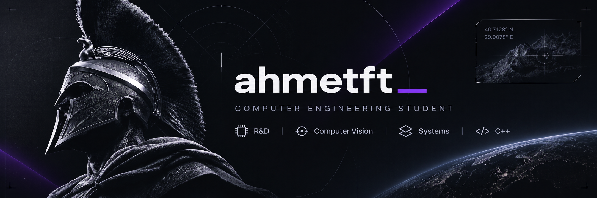
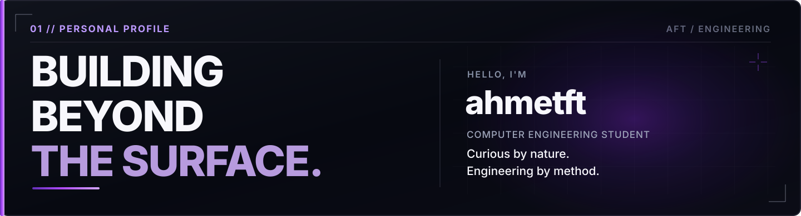
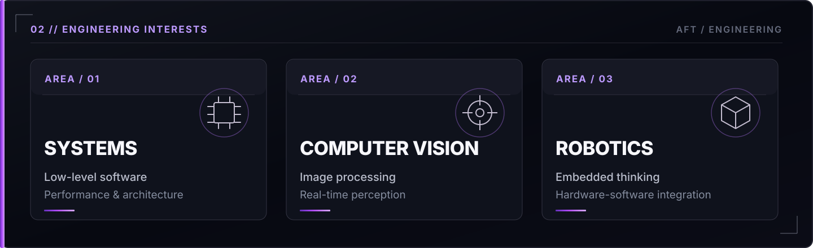
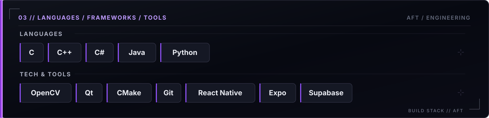
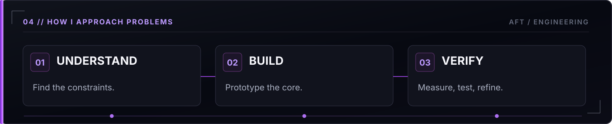
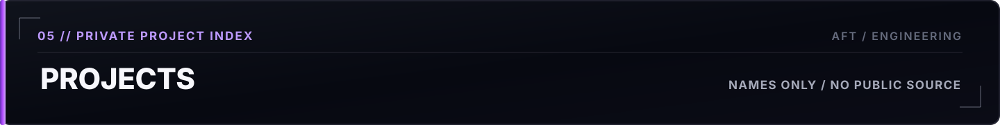
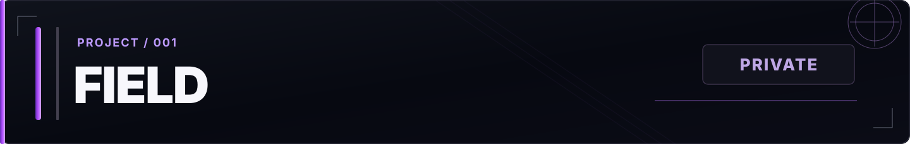
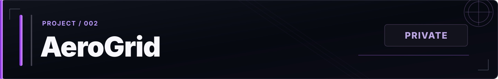
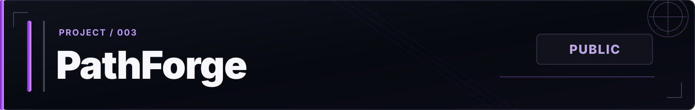
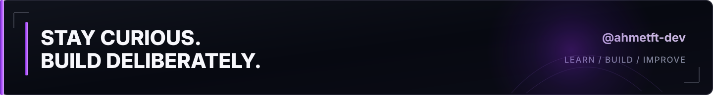

<!--
GitHub profile / ahmetft-dev
All artwork is locally hosted. No third-party stats or tracking widgets.
Private projects are listed by name only. Do not add internal details or private links.
-->

  

  <a href="#about">About</a> &nbsp; / &nbsp;
  <a href="#focus-areas">Focus</a> &nbsp; / &nbsp;
  <a href="#toolchain">Toolchain</a> &nbsp; / &nbsp;
  <a href="#approach">Approach</a> &nbsp; / &nbsp;
  <a href="#selected-work">Selected Work</a>

  

I explore the intersection of **software, hardware, and intelligent systems**. I'm particularly interested in understanding how technology works beneath the surface — from low-level code and performance to computer vision and embedded computing.

I enjoy turning an idea into a working prototype, testing the assumptions behind it, and iterating toward better engineering decisions.

  

  

  

  

  
  

  

